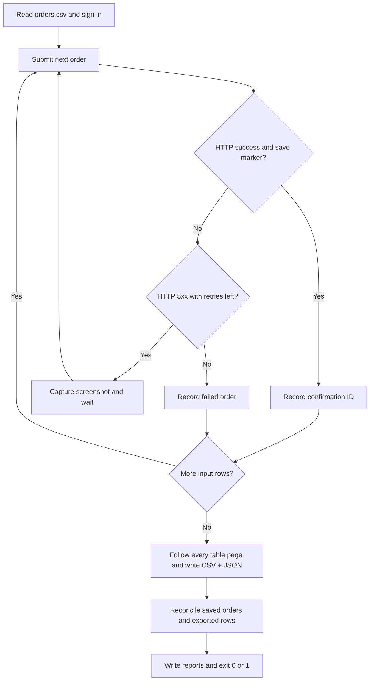

# Playwright Order Portal Demo

Enter six orders from CSV through a local browser form, recover from an injected HTTP 500, and verify that both exports contain every saved order. The default run saves all six orders, retries once, and exports 24 rows across three table pages.

The demo portal listens on `127.0.0.1`, starts with 18 synthetic orders, and resets each run. The same workflow fits authorized internal portals, admin forms, and test sites.



## Quickstart

Use Node.js 20.6 or newer. From the kit directory, install the dependency and Chromium, then run the demo and tests.

```sh
npm install
npx playwright-core install chromium
npm start
npm test
```

### Try the failure modes

| Command | What happens | Exit |
| --- | --- | --- |
| `npm start` | One HTTP 500, then six confirmed orders and 24 rows in both exports. | 0 |
| `npm run demo:fail` | Five early HTTP 500s exhaust the first order's retry budget. The other five orders and 23 exported rows are recorded for inspection. | 1 |
| `npm run demo:bad-auth` | The login returns HTTP 401. The run writes a failure report and an error screenshot. | 1 |

The first retry waits 250 ms by default and the second waits 500 ms. The wait doubles up to 30 seconds if you raise the retry limit. The demo injects failures before the write.

### Run settings

| Variable | Default | Purpose |
| --- | --- | --- |
| `DEMO_USER` | `demo` | Local portal username. |
| `DEMO_PASS` | `demo-pass` | Local portal password. |
| `FAIL_FIRST` | `1` | Number of initial order POSTs that return HTTP 500. |
| `MAX_RETRIES` | `2` | Additional attempts allowed per order after the first submission. |
| `RETRY_BASE_MS` | `250` | Delay in milliseconds before the first retry. |
| `HEADLESS` | `true` | Set to `false` or `0` to watch Chromium. |
| `OUT_DIR` | `out/` | Output directory. Relative paths resolve from the working directory. |

Copy `.env.example` to `.env` and run `node --env-file=.env run.mjs` to load the example settings from a file. Use a different `OUT_DIR` for each concurrent run or to keep earlier results.

## Outputs

| File | Contents | Example |
| --- | --- | --- |
| `out/export.csv` | Table rows with CRLF records and CSV quoting. | [CSV sample](samples/export.csv) |
| `out/export.json` | The same rows as JSON objects with numeric IDs and quantities. | [JSON sample](samples/export.json) |
| `out/report.md` | Status, counts, checks, and an event log. | [Markdown report](samples/report.md) |
| `out/report.json` | Recorded attempts, save confirmations, checks, and screenshot paths. | [JSON report](samples/report.json) |
| `out/shots/` | Screenshots of the form, first confirmation, each table page, and errors. | Created at runtime |

The report checks that every input order was confirmed, that the scraped table matches the portal's records and the seeded-plus-confirmed count, that each saved ID has the expected field values, and that the CSV and JSON agree after both files are read back. A failed check gives the CLI exit code `1` even when it produced both exports.

The test suite covers quoted CSV fields, recovery after one HTTP 500, partial output after exhausting retries, and the sign-in failure screen.

